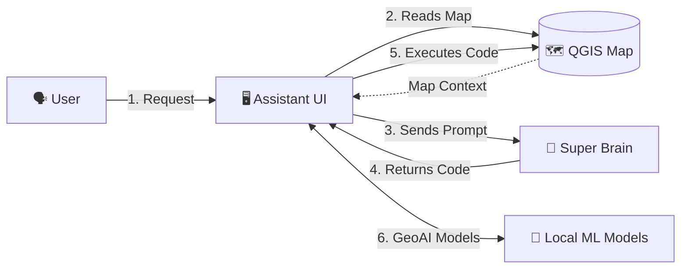
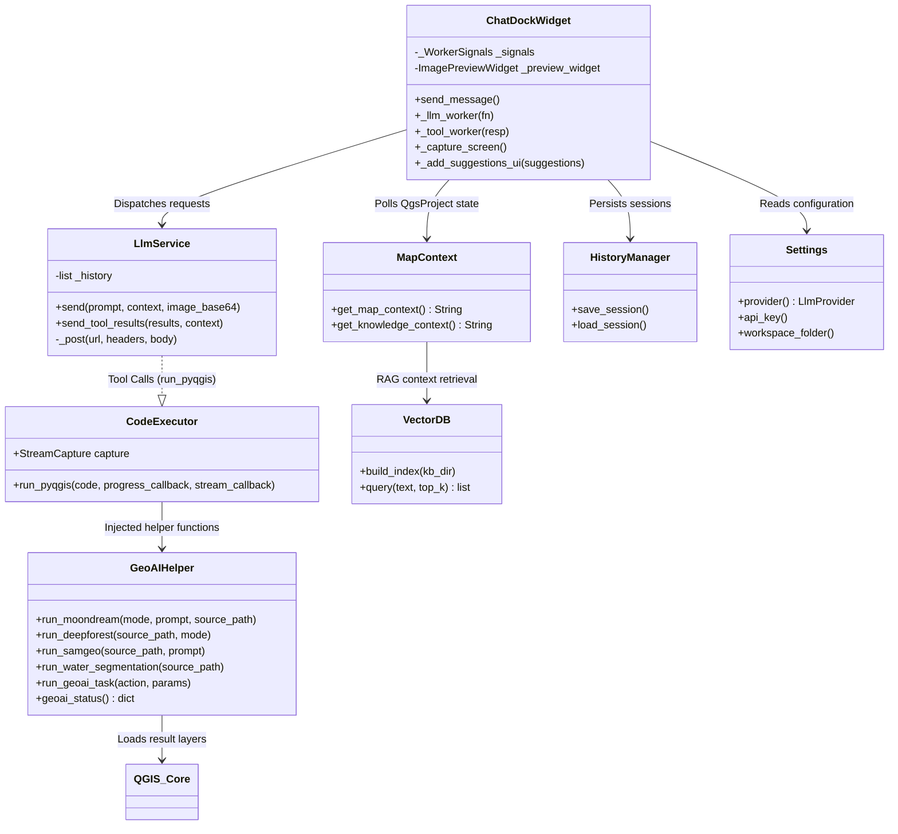
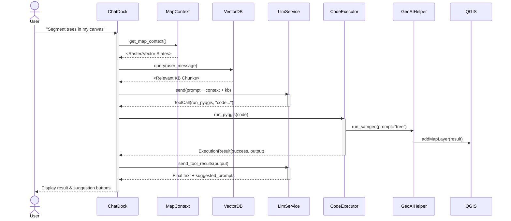

# BADR for QGIS

**BADR** is an advanced AI-powered GIS orchestrator that seamlessly integrates Large Language Models (LLMs) with the QGIS desktop environment. It serves as a natural language bridge for geospatial automation, converting complex user prompts into executable PyQGIS logic while maintaining deep context of the active map canvas, layers, and coordinate systems. It also bridges to local machine learning pipelines through the **GeoAI** plugin.

---

## 🌟 ELI5: How does it work?

Imagine you have a **Magic Assistant** sitting next to you while you work in QGIS.

1. **You Speak:** You say, *"Hey, find all the schools within 500 meters of the main road."*
2. **The Assistant Looks:** It rapidly scans your project—checking which layers exist ("Schools", "Main_Roads"), the active coordinate system, and your current map extent.
3. **The Assistant Thinks:** It bundles your request and the map's current state into a message and sends it to a "Super Brain" (the AI).
4. **The Assistant Acts:** The Super Brain replies with an exact Python script. The Assistant runs this script inside QGIS, calculates the buffers, selects the points, and plots the result on your screen.
5. **It Learns & Recovers:** If it attempts to use a missing tool or encounters a geometry error, it catches the error, tells the brain what went wrong, and tries an alternative approach automatically. If it learns a new rule, it saves it for next time.

### Simplified Workflow

---

## 🏗️ Technical Architecture (Deep Dive)

BADR's architecture is a multi-modal, asynchronous, context-aware engine designed to interface between PyQt-based user interfaces, the C++ QGIS core (via PyQGIS), RESTful LLM endpoints, and local GeoAI ML pipelines.

### Component Interaction Architecture

### ⚙️ Detailed Execution Workflow

The system relies on an autonomous tool-calling loop:

---

## 📂 Codebase Dissection (File-by-File)

BADR is structured to decouple UI, context extraction, API communication, script sandboxing, and local ML inference. Here is the extreme technical breakdown of every core component:

### 1. `plugin.py`
**Purpose:** The entry point for QGIS.
**Technical Detail:** Implements the required `initGui` and `unload` methods for QGIS plugins. It injects a new `QAction` into the QGIS toolbar and handles the instantiation of the `ChatDockWidget`. It acts as the bridge linking the standalone plugin logic to the `qgis.utils.iface` reference.

### 2. `chat_dock.py`
**Purpose:** The central UI orchestrator and state manager.
**Technical Detail:**
- Inherits from `QDockWidget` and constructs a modern chat interface using PyQt5.
- **Multi-Modal Vision:** Implements `SmartTextEdit` and `ImagePreviewWidget`, allowing users to paste images or capture the `QgsMapCanvas` via `_capture_screen()`. Images are base64-encoded via `QBuffer`.
- **Asynchronous Execution:** Uses standard Python `threading.Thread` and `QObject` signals (`_WorkerSignals`) to prevent blocking the QGIS main event loop during network requests or long geoprocessing tasks.
- **Dynamic UI Rendering:** Manages `ChatBubble` instances, including polymorphic bubbles for "Thinking...", "Progress...", "Console Output", and code block rendering.
- **Suggested Next Actions:** After each AI response, parses `<suggested_prompts>` XML tags and renders clickable pill buttons below the assistant bubble. Clicking a button automatically submits that follow-up prompt.
- **Abort Control:** A stop button (red square icon) is shown while processing. Clicking it sets `_is_aborted = True`, cancelling the current AI round-trip and cleaning up the thinking bubble.
- **Context-Menu Lesson Saving:** Right-clicking any assistant bubble shows options to save the message as a Lesson Learnt or copy the text.
- **Session History Browser:** A `HistoryDialog` lists past sessions with delete/load support.

### 3. `llm_service.py`
**Purpose:** The multi-provider LLM abstraction layer.
**Technical Detail:**
- Normalizes requests and responses across **Anthropic, Google Gemini, and OpenAI-compatible** architectures.
- **Prompt Engineering:** Injects the `_SYSTEM_PROMPT_BASE`, setting strict guidelines on how the LLM should interact with PyQGIS (e.g., using `processing.run`, error recovery instructions, workspace output rules).
- **Google Earth Engine (GEE) Injection:** Dynamically appends specialized instructions if a GEE project is configured. This includes a hardcoded recursive tiling and fallback download script to bypass GEE's strict 50 MB payload limits natively.
- **GeoAI Injection:** Always appends the `_GEOAI_SECTION` detailing the pre-injected helper functions (`run_moondream`, `run_deepforest`, `run_samgeo`, `run_water_segmentation`, `run_geoai_task`, `geoai_status`) so the LLM knows how to call them without any imports.
- **Tool Schema Injection:** Exposes two structured tools to the LLM: `run_pyqgis` (for executing arbitrary Python) and `record_lesson` (for persisting new SOPs).
- **Rate-Limit Retry:** `_post()` implements exponential backoff (up to 3 retries) on HTTP 429 responses, notifying the UI via `retry_callback`.
- **History Trimming:** Implements `trim_history()` to maintain a rolling context window of 40 messages, ensuring tool-use/tool-result pairs are not severed during truncation.

### 4. `code_executor.py`
**Purpose:** The PyQGIS script sandbox.
**Technical Detail:**
- Safely executes LLM-generated code strings using Python's built-in `exec()`.
- **Stream Hijacking:** Implements a custom `StreamCapture` class inheriting from `io.StringIO` to temporally hijack `sys.stdout`. This allows the plugin to capture all `print()` outputs from the script in real-time and stream them to the `ConsoleBubble` in the UI via a `pyqtSignal`.
- **Injected Globals:** Pre-populates the execution environment with `qgis.core`, `qgis.gui`, `qgis.processing`, `iface`, and all GeoAI helper functions (`run_moondream`, `run_deepforest`, `run_samgeo`, `run_water_segmentation`, `run_geoai_task`, `geoai_status`, `download_with_progress`).
- **Progress Intercepting:** Injects a custom `report_progress` callback into the `exec` globals, allowing scripts (and GEE downloads) to emit progress updates directly to the plugin's UI.
- **Abort Gate:** The `is_aborted` callback is also injected, so long-running download loops can check and exit cleanly when the user hits Stop.

### 5. `geoai_helper.py`
**Purpose:** Local machine-learning model bridge (GeoAI plugin integration).
**Technical Detail:**
- Provides pre-built helper functions that BADR injects into every generated script's execution namespace.
- **Canvas Auto-Clipping:** `_clip_raster_to_canvas_extent()` uses GDAL `Warp` to clip any input raster to the current map canvas before passing it to an ML model, skipping the clip only when the canvas already covers >95% of the raster extent.
- **PIL Safety:** `_ensure_within_pil_limit()` resamples oversized rasters that would exceed PIL's 150 M-pixel decompression bomb limit before feeding them to DeepForest.
- **`run_moondream()`:** Drives the GeoAI Moondream VLM via `MoondreamSubprocessClient`. Supports `caption`, `query`, `detect`, and `point` modes. If no `source_path` is provided, automatically grabs the current map canvas as a PNG.
- **`run_deepforest()`:** Drives DeepForest tree-crown / object detection via `DeepForestSubprocessClient`. Pixel coordinates from the model are projected to real-world coordinates using the raster's GeoTransform, then saved as a GeoPackage and auto-loaded into QGIS.
- **`run_samgeo()`:** Drives SAM / SAM2 / LangSAM segmentation. Supports text-prompt, point-prompt, and box-prompt modes. Masks are vectorized via the GeoAI task runner in three modes: `simple`, `smooth`, and `regularize` (building orthogonalization).
- **`run_water_segmentation()`:** Drives OmniWaterMask for water body extraction. Validates band count upfront (requires ≥4 bands) and provides a clear error + SAM alternative suggestion for RGB-only imagery.
- **`run_geoai_task()`:** Low-level pass-through to the GeoAI task subprocess runner for training, tiling, semantic segmentation, and vectorization tasks.
- **`geoai_status()`:** Inspects the GeoAI venv for installed packages (`deepforest`, `segment_geospatial`, `omniwatermask`, `moondream`, `torch`) and returns a structured diagnostics dict.

### 6. `map_context.py`
**Purpose:** Real-time state extraction of the QGIS workspace.
**Technical Detail:**
- Uses the `QgsProject.instance()` to traverse the active layer tree.
- **Vector Introspection:** Determines geometry types (Point, Line, Polygon), active selections, and samples up to 15 fields via `QgsVectorLayer.fields()`.
- **Raster Introspection:** Inspects the `QgsRasterLayer.dataProvider()`, extracting band counts, dimensions, resolution (`rasterUnitsPerPixelX`), and specific band data types (e.g., UInt16, Float32).
- **Workspace Injection:** Injects the configured `BADR_WORKSPACE` path so the AI always knows where to save outputs.
- **Knowledge Context (RAG):** `get_knowledge_context()` queries the `VectorDB` TF-IDF index against the user's current message and appends the top-3 most relevant Knowledge Base chunks as `RELEVANT KNOWLEDGE BASE CONTEXT (RAG)`.
- **Lessons Memory:** Also reads the `lessons.md` file and appends its contents as `LONG-TERM MEMORY & LESSONS LEARNT`.

### 7. `vector_db.py`
**Purpose:** Local TF-IDF Vector Database for Retrieval-Augmented Generation (RAG).
**Technical Detail:**
- A dependency-free TF-IDF engine using pure Python (`collections.Counter`, `math`).
- `build_index()` walks the Knowledge Base directory, chunks all `.md` files by paragraph (empty-line splits), and serializes the inverted IDF weights to a `vector_db.json` file.
- `query()` computes cosine similarity between the tokenized user query and all stored chunks, returning the top-k results with similarity >0.05.
- The index is rebuilt on-demand via the **Update Vector DB** button in Settings and cached on disk.

### 8. `history_manager.py`
**Purpose:** Session persistence.
**Technical Detail:** Determines OS-specific AppData/local share paths to store chat histories as JSON files, maintaining conversation continuity across QGIS restarts.

### 9. `knowledge_base_manager.py`
**Purpose:** UI dialog for SOP management.
**Technical Detail:** Allows users to ingest, copy, and manage `.md` files that represent organizational rules or lessons, serving as persistent RAG context.

### 10. `lessons_dialog.py`
**Purpose:** UI dialog for viewing and editing `lessons.md`.
**Technical Detail:** Opens the accumulated AI lessons in an editable text view, allowing users to curate, correct, or delete individual lesson entries.

### 11. `settings.py` & `settings_dialog.py`
**Purpose:** Configuration persistence and UI.
**Technical Detail:** Wraps `qgis.core.QgsSettings` to store API keys, model preferences, and toggle states securely in the QGIS registry/ini files. Implements an intelligent cache in `settings_dialog.py` to seamlessly hot-swap between Cloud and Local execution modes without losing credentials. Includes a dedicated **Workspace Folder** field with live auto-save on change and an "Open in Explorer" shortcut.

---

## 🚀 Features

### Core AI Capabilities
- **Multi-Modal Vision** — Capture your QGIS canvas or attach images so the AI can "see" your map or errors.
- **Natural Language Geoprocessing** — Convert descriptions into executed `processing.run()` pipelines.
- **Context-Aware Generation** — The AI implicitly knows your projection, layer names, raster bands, and workspace path.
- **Adaptive Execution** — The AI handles `try/except` logic internally and autonomously retries failed operations.
- **Suggested Next Actions** — After every response, up to 2 clickable follow-up prompt suggestions appear as pill buttons.
- **Abort Mid-Processing** — A stop button lets you cancel any in-flight AI request or code execution at any time.

### GeoAI Local ML Integration
- **Moondream VLM** — Caption, query, detect objects, or find points in satellite/aerial imagery using a local vision-language model.
- **DeepForest Tree Detection** — Detect tree crowns or other objects in high-resolution imagery with automatic canvas clipping and pixel-to-map-coordinate projection.
- **Segment Anything (SAM / SAM2)** — Text-prompt, point-prompt, and box-prompt segmentation with simple, smooth, and regularize (building orthogonalization) vectorization modes.
- **OmniWaterMask Water Segmentation** — Automated water body extraction from multispectral imagery (requires ≥4 bands) with OSM refinement masks.
- **Canvas Auto-Clipping** — All spatial ML models automatically clip the input raster to the current map canvas extent before inference (skipping if the canvas already covers >95% of the raster).

### Data & Memory
- **Extensive GEE Support** — Built-in heuristics for downloading large Earth Engine composites with adaptive tiled download and automatic retry.
- **TF-IDF RAG** — A local Vector Database indexes your Knowledge Base markdown files and injects the most relevant passages into each AI prompt.
- **Long-Term Lessons Memory** — Stores procedural lessons locally (auto-recorded by the AI or manually added) to refine future AI behaviors.
- **Persistent Workspace** — All generated files and layers are saved to a user-configured workspace folder, never to system temp.
- **Session History** — Browse, load, and delete past chat sessions.

### Security & Privacy
- **Local Storage** — API keys and histories are stored entirely locally via QGIS settings.
- **Direct Connection** — All API requests route directly from your QGIS instance to the provider's endpoint. There is no middle-man server.

---

## 🛠️ Setup & Installation

### Quick Start
1. Download the latest release `.zip`.
2. In QGIS: Navigate to **Plugins > Manage and Install Plugins > Install from ZIP**.
3. Select the ZIP file and click **Install Plugin**.
4. Click the **BADR** icon in the toolbar, navigate to the **Settings** cog, and configure your preferred provider (e.g., add an API key for Claude or Gemini, or set up a local Ollama endpoint).
5. Set a **Workspace Folder** in Settings so all generated files are saved to a permanent, organized location.

### Requirements
- **QGIS 3.34+**
- (Optional) `pip install earthengine-api` in your OSGeo4W/QGIS environment for GEE functionality.
- (Optional) The **GeoAI** QGIS plugin with its ML dependencies installed for local model inference (Moondream, DeepForest, SAM, OmniWaterMask).

### GeoAI Setup
1. Install the **GeoAI** plugin from the QGIS Plugin Repository.
2. Open the GeoAI panel and click **Install Dependencies** to create its ML virtual environment.
3. In BADR, the GeoAI functions (`run_deepforest`, `run_samgeo`, etc.) are automatically available in every generated script — no extra configuration needed.

### Google Earth Engine Setup
1. **Install API:** `pip install earthengine-api` (in OSGeo4W Shell or QGIS Python console).
2. **Authenticate:** Run `earthengine authenticate` in OSGeo4W Shell.
3. **Cloud Project:** Enable Earth Engine API on your Google Cloud Project.
4. **Configuration:** Enter your Cloud Project ID in the BADR Settings > **GEE Project** field.

---

## 🔒 Security & Data

- **Local Storage:** API keys and histories are stored entirely locally on your machine via QGIS settings.
- **Direct Connection:** All API requests route directly from your QGIS instance to the provider's endpoint (Anthropic, OpenAI, Google) or your `localhost`. There is no middle-man server inspecting your map data or queries.
- **Local ML Models:** GeoAI model inference runs entirely on your local machine through a sandboxed virtual environment managed by the GeoAI plugin.
