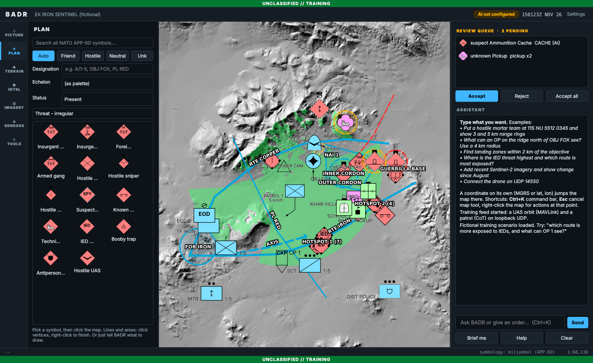

# BADR 2 — AI-first military planning GIS

BADR 2 is a standalone planning and analysis application built on the QGIS engine.
It replaces the QGIS interface with one screen designed around a planner's
workflow, speaks NATO APP-6D symbology natively, uses Google Earth Engine as its
data back end, and puts an AI assistant in charge of the routine work.

> **Scope.** Planning and analysis only. Sensor links are receive-only; BADR
> never commands a platform and does not direct engagements. Everything the AI
> adds to the map is held for human review before it joins the picture.

The original BADR plugin (repository root) is untouched; everything here lives
under `badr2/`.



## What changed from BADR 1

| | BADR 1 (QGIS plugin) | BADR 2 |
|---|---|---|
| Form | chat dock inside QGIS | standalone application on the QGIS engine |
| How the AI acts | writes PyQGIS scripts, runs them, retries on error | calls 16 terse structured tools; code is a gated last resort |
| Per-request cost | long prompt (script templates, full map state) every turn | short cached prompt; map state read on demand; routine orders use no model at all |
| Symbology | none | full NATO APP-6D, 1,647 catalogued entities |
| Sensors | none | any transport × any protocol, receive-only |
| Human control | optional confirm | review queue for all AI additions |

### Speed and token use

BADR 1 was slow and token-hungry because every request sent a large system
prompt plus the whole map state, and the model answered by writing code that
often needed several retry rounds. BADR 2 changes the mechanics:

- **Structured tools, not generated code.** "Viewshed from OP 1, 4 km" is one
  short tool call instead of a 60-line script.
- **Nothing sent that is not needed.** Tool definitions and the system prompt
  are sent with every request, so they are kept to about 2,000 tokens in
  total; a test fails the build if they grow past the budget.
- **Zero-token fast path** (`badr/ai/quick.py`). Greetings, and orders with a
  fixed shape (go to, range rings, viewshed, line of sight, route, mobility,
  landing zones, grid, cordon, hotspots, basemap), are handled locally.
- **One model call per request where possible.** The assistant answers through
  a `brief` tool in the same turn as its actions, so there is no second round
  trip just to phrase the reply.
- **Short answers.** At most five sentences of sixteen words, playable on the map.
- **Context on demand.** The map state is read with `get_picture` only when needed.
- **Fast default model** with a Fast / Balanced / Deep setting, a 90-second
  timeout, and a per-request token readout.

Measured against the live Claude API (`claude-haiku-5-5`, Fast) on the demo:
a greeting costs nothing; a place-and-draw order took 2.7 s in one call
($0.0007); a route-exposure question 3.4 s in two calls; a full brief 7.4 s in
three. Fixed overhead is about 3,600 input tokens per call, cached after the
first. BADR 1 was not measured the same way, so no like-for-like ratio is claimed.

## The screen

Nine modes replace QGIS' menus, toolbars and docks:

| Mode | What it is for |
|---|---|
| **Contents** | map layers in drawing order, attribute tables, basemap, open/new operation, export |
| **Catalog** | geodatabases: feature datasets, feature classes, tables, fields, domains |
| **Plan** | APP-6D symbol palette and search, control lines and areas |
| **Draw** | draw into your own quick layers or into geodatabase feature classes |
| **Terrain** | elevation, viewshed, line of sight, mobility, routes, landing zones, range rings, GRG, cordon |
| **Intel** | incident logging, hotspots, pattern-of-life matrix, route threat |
| **Imagery** | Earth Engine products, change detection, OpenStreetMap reference data |
| **Sensors** | connections, live devices, classification, video |
| **Tools** | every QGIS processing algorithm, searchable, grouped by planning task |

**On the map:** click selects a feature and shows its attributes in the
inspector (editable in place); Ctrl+click adds to the selection; Shift+drag
box-selects; drag pans; right-click opens actions for that feature or spot;
Delete removes the selection. The map toolbar has select, measure, zoom,
attribute table and export.

**Right sidebar:** inspector, review queue, and the assistant. Answers arrive
as a few short sentences; **Play** flies the map to each one in turn.

**Export:** Contents → Export data writes any layers to GeoPackage, Shapefile,
GeoJSON, KML, CSV or a file geodatabase (WGS84). NATO symbols carry their SIDC
so other systems can re-symbolise them.

Operations are held in memory and autosaved to `cop.gpkg` in the operation
folder (atomic write) a moment after each change and on exit.

## Capabilities

**NATO symbology (APP-6D / MIL-STD-2525D).** Rendered by the bundled
[milsymbol](https://github.com/spatialillusions/milsymbol) library inside Qt's
JavaScript engine: frames, echelons, status, HQ/task-force, modifiers, direction
arrows and text amplifiers. Symbols are ordinary QGIS symbology (an expression
function feeding an SVG marker), so they also work in exports. A curated
palette puts sub-conventional operations first: irregular threat, threat sites,
25 incident types, human terrain, control points, lines and areas. The full
catalog is searchable by plain words ("safe house", "IED", "checkpoint").

**Terrain.** Viewshed, line of sight with earth curvature, GO / SLOW-GO / NO-GO
mobility for wheeled, tracked and dismounted movers, least-cost cross-country
routes with time estimates, helicopter landing-zone candidates, range rings,
gridded reference graphics, cordon rings. Slope thresholds are planning
approximations and are parameters, not doctrine.

**Incident pattern analysis.** Spatial hotspots (DBSCAN), hour × weekday
pattern of life with peak windows, and route exposure ranking.

**Google Earth Engine.** Sentinel-2 (true/false colour, latest pass), Sentinel-1
radar, Landsat, NDVI, Copernicus 30 m elevation, ESA WorldCover, VIIRS night
lights, JRC surface water, Dynamic World built-up; optical and radar change
detection; streamed as tiles or downloaded for analysis. Without Earth Engine,
elevation falls back to open terrain tiles and everything else still works.

**All of QGIS.** QGIS is open source, so nothing was reverse-engineered: BADR
links the engine directly. `badr/analysis/capabilities.py` indexes the live
processing registry (373 algorithms on the QGIS 3.34 build tested here; more
when GRASS or SAGA are installed), files each under a planning workflow, and lets the UI or the AI run any of
them by id.

**Geodatabases (Catalog).** Create Esri file geodatabases (`.gdb`, written
through GDAL's OpenFileGDB driver) and GeoPackages; organise them with feature
datasets (shared coordinate system), feature classes, tables, fields with
aliases, and coded-value domains; import any map layer; add classes to the map
and draw into them. See `badr/core/geodatabase.py`.

**Sensors and devices.** A connection is a transport plus a protocol, chosen
independently — no vendor-specific code path.

| Transports | Protocols |
|---|---|
| UDP (unicast / multicast), TCP client, TCP server, serial / USB, HTTP poll, MQTT, file replay | Cursor-on-Target (TAK), MAVLink v1/v2, NMEA 0183, ADS-B SBS-1, JSON / GeoJSON with field mapping |

Every decoder produces the same `Observation`, which becomes a live track with
a NATO symbol, a trail and (when reported) a sensor footprint. The operator
classifies tracks. Adding a protocol is one class with a `feed(bytes)` method.

**AI assistant.** Claude by default (official SDK), or any OpenAI-compatible
endpoint — including Ollama or an on-premises server for air-gapped use.

## Install and run

Requires QGIS 3.34 LTR or newer. BADR runs on QGIS' own Python.

```sh
# Linux (Debian/Ubuntu)
sudo apt install qgis python3-qgis python3-pyqt5.qtquick
python3 -m pip install -r requirements.txt
./run_badr.sh --demo            # fictional training scenario
```

### Windows

Two downloads are produced by the **BADR 2 Windows build** workflow
(GitHub → Actions → latest run → Artifacts; tagged builds `badr2-v*` are also
published under Releases):

| Download | Use it when |
|---|---|
| `BADR-Setup.exe` | You want one installer with everything inside. QGIS is bundled; no admin rights needed. |
| `BADR-2-windows-lite.zip` | QGIS 3.34+ is already installed. Unzip anywhere and run `BADR.exe`. |

`BADR.exe` is a small native launcher (`packaging/launcher.c`). It looks for
the bundled runtime first, then an installed QGIS (`BADR_QGIS_ROOT`,
`OSGEO4W_ROOT`, `Program Files\QGIS *`, `C:\OSGeo4W`), starts BADR without a
console window and writes `%LOCALAPPDATA%\BADR\badr.log`. The Start menu gets
"BADR" and "BADR (training demo)".

The installer is not code-signed, so Windows SmartScreen will warn on first
run ("More info" → "Run anyway"). Sign it with your organisation's certificate
before wider distribution.

From source, `run_badr.bat --demo` still works with an existing QGIS install.

`--demo` loads a fictional exercise over a public training area and starts a
simulated UAS and patrol feed over loopback UDP. In **Settings** add an AI
provider key (or pick a local model) and, for imagery, a Google Cloud project
registered for Earth Engine (`earthengine authenticate` once).

`python3-pyqt5.qtquick` provides the JavaScript engine for full APP-6D
rendering; without it BADR falls back to a basic built-in frame renderer.

## Tests

```sh
QT_QPA_PLATFORM=offscreen python3 -m pytest tests -q     # 96 tests
```

Covered: MGRS against a reference library; symbol codes, search and rendering;
every terrain tool on a synthetic ridge; pattern analysis; the QGIS algorithm
index; all five decoders including fragmented and corrupt input; live feeds
over real UDP sockets; every AI tool; the agent loop; both LLM wire formats;
the main window, fast path and review queue.

**Not verified here:** live Earth Engine requests (tested against a stand-in
module only), real drones/radios/serial devices, MQTT, video playback, opening
the created `.gdb` in ArcGIS itself, and macOS.

## Layout

```
badr/
  app.py            bootstrap (QgsApplication + Processing)
  core/             MGRS, geodesy, settings, COP store, workbench
  symbology/        SIDC, catalog, milsymbol engine, palette, QGIS styles
  analysis/         terrain, pattern, DEM, OSM, QGIS capability index
  gee/              Earth Engine client
  sensors/          model, transports, decoders, device manager, simulator
  ai/               LLM clients, tools, agent loop, fast path, code executor
  ui/               main window, panels, map tools, theme
tools/              APP-6D catalog builder
tests/
```

## Licences

BADR 2 links QGIS and is therefore distributed under the GNU GPL v2 or later.
Bundled: milsymbol (MIT); APP-6D tables from stanag-app6 (MIT).

## Next steps worth considering

- STANAG 4609 / MISB KLV video metadata for true sensor footprints
- Multi-point APP-6 tactical graphics (currently simplified line/area styles)
- Print-layout briefing products and overlay export (KML, NVG)
- Multi-user operation sharing
